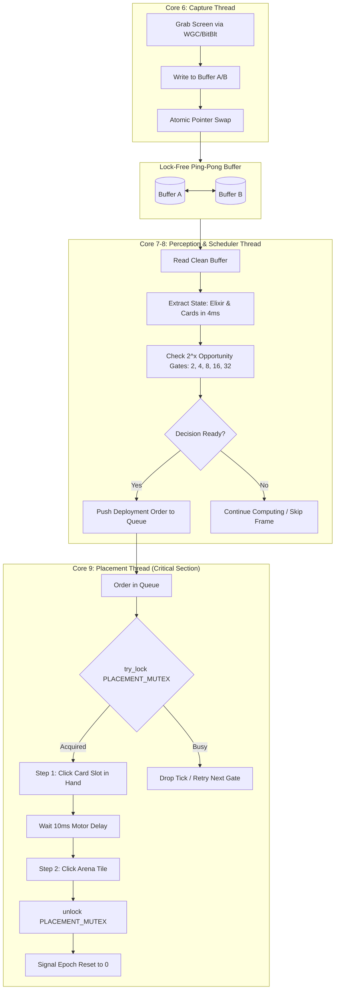

# Clash Royale Autonomous AI — System Architecture & Peer-Review Specification

> **Document Version:** 1.0.0  
> **Target Application:** Clash Royale on PC (Google Play Games Hypervisor / Win32)  
> **Author & Architect:** Divyansh & Antigravity  
> **Purpose:** Comprehensive architecture specification, hardware telemetry mapping, and peer-review evaluation guide.

---

## 1. Executive Summary & Problem Formulation

Standard game bots suffer from two fatal engineering flaws:
1. **Per-Frame Processing (60 FPS Polling):** Evaluating deep neural models on all 60 frames/sec causes massive queue delay, GPU throttling, and input latency spikes.
2. **Fixed-Interval Timer Polling (e.g., 200ms/500ms):** Highly robotic, predictable, easily exploited by opponents, and blind to fast millisecond events (Zap/Log/Swarm drops).

### The Proposed Paradigm Shift:
An asynchronous, multi-threaded perception and action execution system combining:
1. **Hierarchical Binary Exponential Frame Scheduling ($2^x$ Dyadic Decomposition):** Sub-dividing 60 frames into $\{32, 16, 8, 4\}$ blocks with execution gates at $2, 4, 8, 16, 32$ frames ($33.3\text{ms} \to 533.3\text{ms}$).
2. **Simultaneous Tri-Threaded Concurrency with Strict Mutual Exclusion:** Decoupling Capture, Perception, and Input Placement across dedicated CPU cores with lock-free double buffering and a two-phase atomic placement mutex.

---

## 2. Host Hardware Profile & Thread Allocation

### System Specifications:
* **Processor (CPU):** Intel(R) Core(TM) 7 240H (10 Cores, 16 Logical Threads, up to 5.0 GHz)
* **Memory (RAM):** 16,384 MB (16 GB DDR5)
* **Graphics (GPU):** Dedicated NVIDIA GeForce RTX Laptop GPU + Intel Iris Xe
* **Operating System:** Windows 11 Home 64-bit (Build 26300)
* **Game Runtime:** Google Play Games PC (`crosvm.exe` hardware-accelerated hypervisor)

### Dedicated Core Affinity Mapping:
With 16 logical threads available, the system can run all AI engines in true hardware parallelism with zero OS starvation:

```
[Logical Core 0-1]  -> Windows OS Kernel & Background Services
[Logical Core 2-5]  -> Google Play Games PC & crosvm Hypervisor (Clash Royale)
[Logical Core 6]    -> THREAD A: Ultra-Fast Screen Capture (DXGI / WGC) [Core-Pinned]
[Logical Core 7-8]  -> THREAD B: CV State Perception & 2^x Dyadic Scheduler
[Logical Core 9]    -> THREAD C: Two-Phase Input Placement Engine (Mutex-Gated)
[Logical Core 10-15]-> Available Headroom / Spare Compute
```

---

## 3. Algorithm 1: Dyadic $2^x$ Opportunity Scheduler

### A. Binary Frame Decomposition ($60 = 32 + 28$)
A 60 FPS video stream yields 1 frame every **16.667 ms**. The 60-frame second is recursively decomposed into power-of-two blocks:
$$\mathbf{60 = 32 + 16 + 8 + 4} \quad (\text{Exact Binary Representation: } 111100_2)$$

```
[============================= 60 Frames (1 Second = 1000 ms) =============================]
|---------- Block 1 (32) ----------|---- Block 2 (16) ----|--- Block 3 (8) ---|-- Block 4 (4) -|
Frame 1                         32 33                  48 49               56 57              60
```

### B. Geometric Opportunity Gates:
Inside each active block, execution opportunities are positioned exclusively at powers of two:
* **Gate 2 ($2^1$ = 2 frames = 33.33 ms):** Reflex Gate (Instant spell / counter swarm).
* **Gate 4 ($2^2$ = 4 frames = 66.67 ms):** Micro-Decision Gate (Fast counter deployment).
* **Gate 8 ($2^3$ = 8 frames = 133.33 ms):** Tactical Gate (Cannon / Tesla pull placement).
* **Gate 16 ($2^4$ = 16 frames = 266.67 ms):** Complex Evaluation Gate (Elixir trade calculation).
* **Gate 32 ($2^5$ = 32 frames = 533.33 ms):** Macro-Strategy Gate (Passive wait / elixir buildup).

### C. Dynamic Epoch Reset & Event Preemption:
1. **Instant Reset:** As soon as an action is ready and dispatched at a gate, the window epoch **instantly resets to Frame 0**. It does *not* wait for the remaining frames of the 32 or 16 block to finish. This creates an organic, non-robotic reaction cadence.
2. **Emergency Preemption Interrupt:** If the vision engine detects a sudden high-threat event (e.g. Sparky at bridge or Goblin Barrel in flight) while in a slow 32-frame cycle, the slow window is aborted immediately and snapped back to **Gate 2 (33.33 ms)**.

---

## 4. Algorithm 2: Tri-Threaded Simultaneous Execution & Mutual Exclusion

To achieve simultaneous multi-core performance without memory corruption or input clashing:



### Key Concurrency Mechanisms:
1. **Ping-Pong Double Buffering (Capture $\leftrightarrow$ Perception):**
   * Capture writes to Buffer A while Perception reads from Buffer B.
   * On frame completion, an atomic pointer swap occurs.
   * Neither thread ever blocks or waits on an OS mutex.
2. **Immutable Game State Snapshot:**
   * Perception publishes state via an atomic pointer (`std::atomic<GameState*>`).
   * Placement reads an immutable snapshot; dirty reads are mathematically impossible.
3. **Two-Phase Placement Mutex (`PLACEMENT_MUTEX`):**
   * Card deployment in Clash Royale is a non-atomic physical interaction:  
     $$\text{Action} = \text{Click}(\text{Card Slot}) \xrightarrow{\Delta t \approx 10\text{ms}} \text{Click}(\text{Arena Tile})$$
   * `PLACEMENT_MUTEX` protects this critical section with non-blocking `try_lock()`.
   * If a placement is underway, no incoming order can disrupt or interleave mouse events.

---

## 5. End-to-End Latency Budget Analysis

Can an action physically occur within the **33.33 ms (Gate 2)** budget?

$$\begin{array}{|l|r|l|}
\hline
\textbf{Pipeline Stage} & \textbf{Latency} & \textbf{Technique / Optimization} \\
\hline
\text{1. Screen Buffer Capture} & 2.5\text{ ms} & \text{DXGI / WGC Direct Memory Copy} \\
\text{2. State Extraction (Elixir + Cards)} & 4.0\text{ ms} & \text{HSV Purple Mask + Normalized Template Match} \\
\text{3. Reflex Decision (System 1)} & 0.8\text{ ms} & \text{In-Memory Priority Rule Matrix} \\
\text{4. Input Injection (PostMessageW)} & 0.2\text{ ms} & \text{Asynchronous Win32 Kernel Message} \\
\hline
\textbf{Total Fast-Path Reaction} & \mathbf{\approx 7.5 \text{ ms}} & \textbf{Well within Gate 2 (33.33 ms) deadline!} \\
\hline
\end{array}$$

* **Conclusion:** 7.5 ms $\ll$ 33.33 ms. The system has **~25 ms of idle headroom** inside Gate 2, ensuring zero deadline overruns.
* **Complex Path:** Decisions requiring multi-card evaluation (20–45 ms) naturally dispatch at **Gate 4 (66.67 ms)**.

---

## 6. Peer-Review Prompt for External AI Consultation

Aap neeche diye gaye box ke text ko copy karke kisi bhi doosre AI (jaise **Claude 3.5 Sonnet**, **GPT-4o**, ya **DeepSeek-R1**) mein paste kar sakte hain ek independent expert review lene ke liye:

```text
==============================================================================
PEER REVIEW REQUEST: CLASH ROYALE AUTONOMOUS AI ARCHITECTURE
==============================================================================

Please review the following real-time game AI architecture designed for 
Clash Royale running at 60 FPS on Windows 11 (Intel Core 7 240H, 16GB RAM):

1. FRAME SCHEDULING (Dyadic 2^x Opportunity Windowing):
   - Rather than polling every frame (16.67ms) or fixed interval (200ms), 
     1 second (60 frames) is decomposed into greedy binary blocks: 60 = 32 + 16 + 8 + 4.
   - Action dispatch opportunities are placed at powers of two: 
     2 frames (33.3ms), 4 frames (66.7ms), 8 frames (133.3ms), 16 frames (266.7ms), 
     and 32 frames (533.3ms).
   - Once a decision is computed, it dispatches at the earliest available 2^x gate 
     and immediately resets the window epoch to 0 (dynamic cadence, non-robotic).
   - High-threat events trigger an emergency interrupt, resetting directly to the 
     Gate 2 (33.3ms) reflex window.

2. CONCURRENCY & MUTUAL EXCLUSION:
   - Thread A (Capture): Writes to a double-buffered Ping-Pong image memory (A/B) 
     with atomic pointer swap (zero mutex blocking).
   - Thread B (Perception & 2^x Scheduler): Reads clean buffer, extracts state 
     (HSV elixir gauge + template matched cards in 4ms), and queues orders.
   - Thread C (Input Placement): Executes a two-phase physical drop 
     [Card Slot Click -> 10ms delay -> Arena Tile Click]. Protected by a 
     non-blocking `try_lock(PLACEMENT_MUTEX)` critical section to prevent 
     interleaved or corrupted clicks.

QUESTIONS FOR REVIEW:
1. Is the dyadic 2^x decomposition (60 = 32 + 16 + 8 + 4) mathematically sound and 
   effective for real-time game bot reaction curves?
2. Are there any race conditions, deadlocks, or lock contention risks in the 
   Ping-Pong buffer + Two-Phase Placement Mutex design?
3. With an Intel Core 7 240H (16 logical threads), will this multi-threaded design 
   cause CPU cache thrashing or thread starvation against Google Play Games PC?
4. What edge cases or improvements would you recommend before live deployment?
==============================================================================
```
