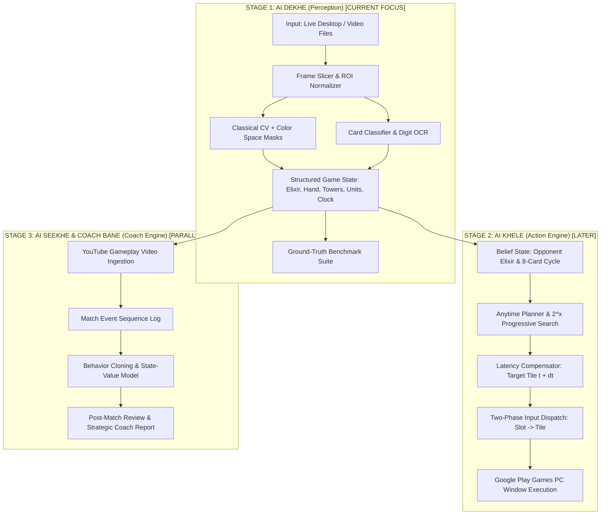

# CLASH ROYALE AUTONOMOUS AI & COACHING ENGINE
## Master Project Context Window & Architectural State Record
> **Persistent State Document for AI Agents & Developers**  
> **Location:** `E:\cr_ai\PROJECT_CONTEXT_WINDOW.md`  
> **Last Synchronized:** 2026-11-09  

---

## 1. PROJECT IDENTITY & CORE OBJECTIVE
The goal is to build an elite, latency-aware, belief-driven Clash Royale AI and Post-Match Coaching system running on Windows 11 over Google Play Games PC.

The project is strictly decomposed into **3 independent milestones**:
1. **STAGE 1: AI DEKHE (Perception Engine)** — Real-time & offline extraction of structured game states with verified accuracy.
2. **STAGE 2: AI KHELE (Action & Bot Engine)** — Live input injection, latency compensation, and active gameplay.
3. **STAGE 3: AI SEEKHE & COACH BANE (Strategic Learning & Coaching Engine)** — Passive learning from top YouTube gameplay videos, building match event logs, player style modeling, and post-match strategic coaching.

---

## 2. HARDWARE & OPERATING ENVIRONMENT PROFILE
* **Host Machine:** ASUS Vivobook 16 (`V3607VU`)
* **Processor (CPU):** Intel(R) Core(TM) 7 240H (10 Cores, 16 Threads; Hybrid architecture: 6 Performance Cores + 4 Efficient Cores, up to 5.0 GHz)
* **Memory (RAM):** 16,384 MB (16 GB DDR5)
* **Graphics (GPU):** Dual GPU — NVIDIA GeForce RTX 4050 Laptop GPU (6 GB VRAM) + Intel Iris Xe
* **Operating System:** Windows 11 Home 64-bit (Build 26300)
* **Game Runtime:** Google Play Games PC (`crosvm.exe` hardware-accelerated hypervisor)
* **Input Desktop Capture:** Win32 Desktop Hook (`user32.OpenInputDesktop` + `mss` / WinRT DXGI)

---

## 3. THREE-STAGE MILESTONE ARCHITECTURE

### Relationship Rules & Invariants:
1. **Stage 1 is the Absolute Foundation:** If the AI cannot perceive state accurately, both Stage 2 and Stage 3 will fail due to error propagation.
2. **Stage 2 and Stage 3 are Independent:** Stage 3 (Coaching) does **NOT** require Stage 2 (Action Injection). Stage 3 learns passively from video files.
3. **Execution Sequence:** **Stage 1 FIRST**. Once Stage 1 benchmark metrics are achieved, proceed to Stage 3 or Stage 2.

---

## 4. CRITICAL ARCHITECTURAL DECISIONS & PEER REVIEW CONSENSUS

Through rigorous multi-perspective peer review (User + Claude + GPT + Antigravity), the following architectural laws are finalized:

### A. Gate Quantization Latency Trap (Resolved)
* **The Flaw:** Artificial power-of-two waiting gates ($2, 4, 8, 16, 32$) must **never** artificially delay an action once computed. If an action is ready at frame 5, waiting until frame 8 injects harmful delay.
* **The Solution:** $2^x$ is repurposed as **Anytime Compute Budget & Progressive Search Depth**:
  - $2-4$ frames ($33-66\text{ ms}$): Fast reflex fallback (counter swarm, immediate zap).
  - $8-16$ frames ($133-266\text{ ms}$): Tactical counter & tile placement.
  - $32$ frames ($533\text{ ms}$): Macro-strategy & passive elixir accumulation.
  - **Immediate Dispatch:** The instant a decision is ready, it is dispatched on the very next frame tick.

### B. Single-Producer Single-Consumer (SPSC) Lock-Free Action Pipeline
* **The Flaw:** A `try_lock` mutex that drops deployment orders causes critical gameplay failure (e.g. dropped defensive drop = lost tower).
* **The Solution:** Use an ordered, lock-free SPSC queue. The decision engine writes orders; the input executor consumes them deterministically without dropping orders or tearing memory.

### C. Hybrid CPU Affinity (Resolved)
* **The Flaw:** Rigid manual CPU affinity masks fail on Windows 11 hybrid architectures (P-cores vs E-cores) and cause thread starvation.
* **The Solution:** Use Windows thread priority APIs (`THREAD_PRIORITY_HIGHEST` for capture/placement, `THREAD_PRIORITY_NORMAL` for heavy inference) and let the Windows 11 Thread Director intelligently route workloads.

### D. Belief-State Modeling (Opponent Elixir & Cycle Tracking)
* Pure visual detection is insufficient because Clash Royale has critical hidden variables.
* The system tracks:
  1. **Opponent Elixir Math:** Starts at 5 elixir, accumulates at $+1\text{ per } 2.8\text{s}$ (regular) or $+1\text{ per } 1.4\text{s}$ (double elixir), decrements upon opponent card deployment.
  2. **Opponent 8-Card Cycle:** Tracks the 4 active hand cards vs 4 queued cards based on deployed card order.

---

## 5. ACTIVE MANDATE: WHERE ARE WE WORKING RIGHT NOW?

> ### 🎯 ACTIVE FOCUS: **STAGE 1 — AI DEKHE (Perception Engine)**
> **Rule:** No code for Stage 2 (playing) or Stage 3 (coaching) shall be written until Stage 1 achieves its verification targets on labeled ground-truth datasets.

### Stage 1 Core Modules:
| Module | Location | Purpose | Status |
| :--- | :--- | :--- | :--- |
| **Window & Desktop Capture** | `src/connect/cr_launcher.py` | Attach to interactive desktop / GPG PC window | ✅ Working (1920x1200 capture verified) |
| **ROI Slicer & Homography** | `src/vision/roi.py` & `homography.py` | Slices Elixir, Hand, Arena, Towers into $18 \times 32$ grid | ✅ Working |
| **Component Detector** | `src/vision/component_detector.py` | Classical CV + HSV color masks for 14 HUD components | ✅ Working |
| **Ground-Truth Benchmarker** | `scripts/evaluate_perception.py` | Evaluates detection accuracy on labeled frames | 🔄 **IN PROGRESS** |
| **Template & Feature Matcher** | `src/vision/card_matcher.py` | Identifies 110+ cards in 4 hand slots + next slot | 📋 Next |
| **Digit & Bar State Extractor** | `src/vision/digit_reader.py` | OCR / mask for Elixir level ($0.0-10.0$) and Tower HP | 📋 Next |

---

## 6. GROUND-TRUTH BENCHMARK TARGETS (STAGE 1)

All metrics must be strictly verified against ground-truth labeled frames in `frames/match_yt_01/`:

1. **Elixir Bar Extraction:** Mean Absolute Error (MAE) $\le 0.3$ elixir.
2. **Player Hand Card Identification (4 Slots + Next Slot):** Accuracy $\ge 95\%$ on clean match frames.
3. **Tower HP & Crown Status:** Accuracy $\ge 95\%$ across King and Princess towers.
4. **Match Clock Timer:** Accuracy $\ge 98\%$.
5. **Arena Unit Detection:**
   - Classification precision/recall on deployed troops.
   - Spatial projection error $\le 1$ tile on the $18 \times 32$ arena grid.
6. **Inference Latency Target:** Total Stage 1 perception pipeline $\le 12\text{ ms}$ per sampled frame on host RTX 4050 + Intel Core 7.

---

## 7. HARD CRITERIA: GO / NO-GO TESTS

* **Stage 1 Go/No-Go:** Can the perception engine continuously output valid, high-confidence JSON game states at $\ge 15$ FPS from raw video/screen without crashing or drifting? *(Testable now)*
* **Stage 2 Go/No-Go:** Does Windows input injection (`PostMessageW` or `SendInput`) reliably register card drag-and-drop actions inside the Google Play Games PC `crosvm` hypervisor window without anti-cheat blocks? *(Must verify before Stage 2 build)*
* **Stage 3 Go/No-Go:** Can game events extracted from YouTube replays reconstruct an accurate match event log matching manual human observation? *(Testable after Stage 1)*
